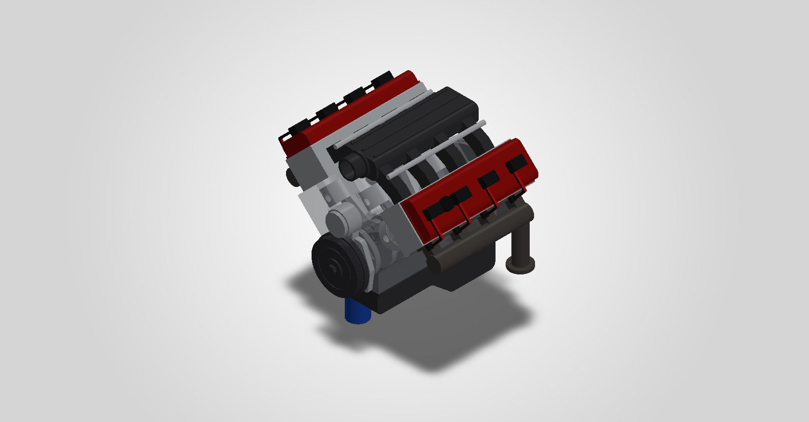
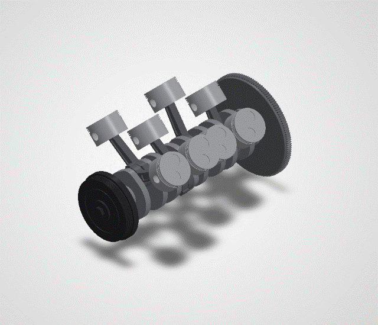
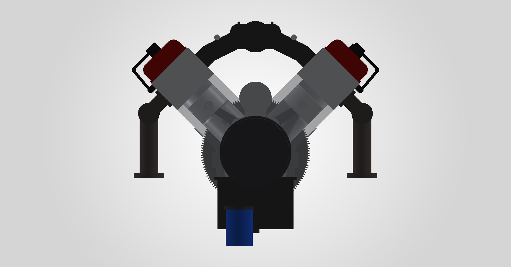
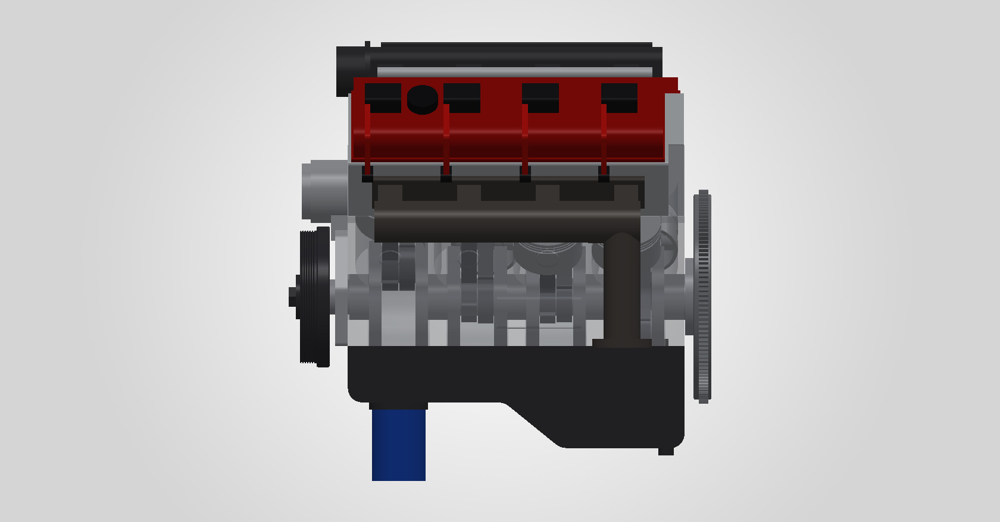
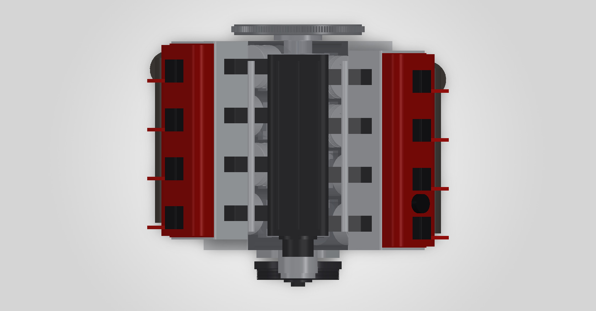
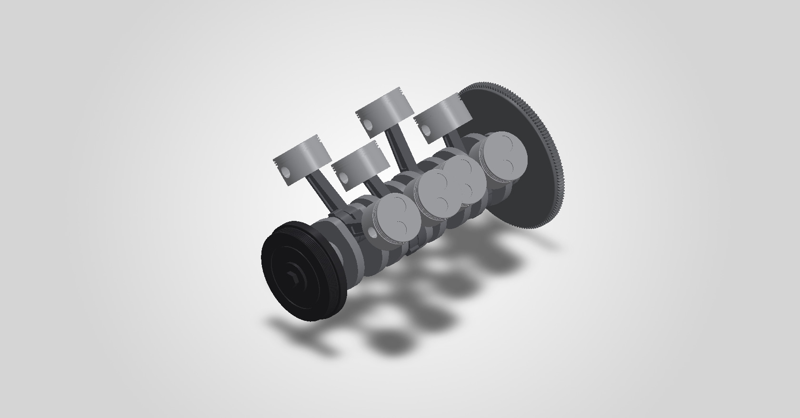

<div align="center">

# V8 Engine

**A working 40-part V8 in SOLIDWORKS 2026, generated entirely by a C# program that drives the SOLIDWORKS API.**

[**Explore it in 3D**](https://anishachar.com/#projects/v8) · [Open the assembly](cad/V8%20Engine.SLDASM) · [Generator source](source/)




</div>

---

A semi-detailed, fully working V8 model. It's based on a GM LS-style small-block but isn't an exact copy of any real engine. **Turn the crankshaft and all 8 pistons and rods move.**

<p align="center">
  
</p>

## Specs

| | |
|---|---|
| Layout | 90° V8, cross-plane crank (throws at 0/90/270/180°) |
| Bore × stroke | 99.0 × 92.0 mm (≈ 5.7 L) |
| Rod length | 154.8 mm |
| Deck height | 234.95 mm |
| Bore spacing | 111.76 mm |
| Cylinder numbering | 1-3-5-7 left bank (driver side), 2-4-6-8 right bank |

**Parts (18 unique, 40 in the assembly):** Engine Block, Crankshaft, Piston ×8, Wrist Pin ×8, Connecting Rod ×8, Cylinder Head L/R, Valve Cover L/R (oil filler cap on the left), Ignition L/R (coil packs, plug leads, boots), Intake Manifold (plenum, 8 runners, throttle body, fuel rails), Exhaust Manifold L/R, Oil Pan (with oil filter and drain plug), Timing Cover (with water pump), Harmonic Balancer, Flywheel (with ring gear).

Not modelled: bolts, gaskets, valvetrain, oil and coolant passages, wiring and the accessory belt.

## Verified

- Piston positions match the slider-crank equation to **0.0000 mm** through a full revolution.
- SOLIDWORKS interference detection finds **no clashes** between moving and fixed parts.

## Renders

| Front | Side | Top |
|:---:|:---:|:---:|
|  |  |  |
| **Rotating assembly** | **Rotating assembly, front** | |
|  |  | |

## Open it in SOLIDWORKS

Open **`cad/V8 Engine.SLDASM`** (keep all the `cad/` files together).

- **By hand:** drag the crankshaft, flywheel or harmonic balancer (the big pulley at the front). The crank can only rotate, so all 8 pistons follow.
- **Animation:** open the **Engine Running** tab at the bottom of the screen and press **Play** (press **Calculate** first if asked). A motor spins the crank at 60 rpm.
- The engine block is see-through so you can watch the pistons. To make it solid, right-click *Engine Block* → **Change Transparency**.

## Rebuild it from source

Every part, the assembly, the mates, the motion study, the renders and the web export are generated by the C# program in [`source/`](source/). Nothing was modelled by hand.

With SOLIDWORKS open:

```powershell
powershell -File source\build.ps1        # compiles bin\V8Builder.exe against your SOLIDWORKS install
source\bin\V8Builder.exe all             # parts, assembly, checks, renders, GIF and motion study
```

You can also build one step at a time, for example `V8Builder.exe piston`. The other steps are `asm`, `verify`, `images`, `gif`, `motion` and `web`. All dimensions live in the `Spec` class in [`source/Parts.cs`](source/Parts.cs).

| File | What it does |
|---|---|
| [`Program.cs`](source/Program.cs) | Entry point: connects to SOLIDWORKS and runs the requested steps |
| [`Parts.cs`](source/Parts.cs) | The `Spec` dimensions and every part's features |
| [`Cad.cs`](source/Cad.cs) | Helpers over the SOLIDWORKS API (sketches, extrudes, cuts, face picking) |
| [`Assembly.cs`](source/Assembly.cs) | Places the 40 components, adds the mates, runs the checks and sets up the motion study |
| [`Gif.cs`](source/Gif.cs) | Stitches the rendered frames into the looping `running.gif` |
| [`Web.cs`](source/Web.cs) | Exports every part's mesh and CAD edges for the website's 3D viewer |
| [`build.ps1`](source/build.ps1) | Compiles the builder with the .NET Framework `csc` |

## Repository layout

```
v8-engine/
├── cad/          # SOLIDWORKS parts (.SLDPRT) and the assembly (.SLDASM)
├── source/       # the C# generator
├── renders/      # still renders and the running animation
└── web-export/   # mesh + edge data used by the 3D viewer on anishachar.com
```

---

<sub>Built by <a href="https://anishachar.com">Anish Achar</a>. Part of my <a href="https://github.com/Anish-Achar">portfolio</a>.</sub>
